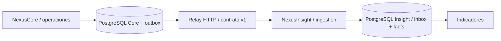

# NexusInsight

[**Abrir demo en GitHub Pages →**](https://idrovodario16.github.io/nexusinsight-analytics/)


**Resumen técnico:** análisis descriptivo de operaciones con JavaScript y React, más una API Python/FastAPI. Base de datos PostgreSQL y consultas SQL para indicadores. Arquitectura modular con ingesta, validación, inbox para deduplicación y modelo analítico propio. Admite fuentes compatibles sin depender de NexusCore. Demo React con localStorage; API ejecutable por separado.

Plataforma de análisis de operaciones multisectoriales. Convierte instantáneas de datos en indicadores, con trazabilidad y sin doble conteo.

[](https://github.com/idrovodario16/nexusinsight-analytics/actions/workflows/ci.yml) · [Demo web](https://idrovodario16.github.io/nexusinsight-analytics/) · [Código de NexusCore](https://github.com/idrovodario16/nexuscore-platform) · [Arquitectura compartida](https://github.com/idrovodario16/nexus-architecture)

## Qué puedes probar

1. Explora los indicadores de 24 operaciones ficticias de logística, comercio y servicios.
2. Filtra por sector, estado, mes o título; los indicadores se recalculan con los mismos filtros.
3. Importa un archivo JSON de eventos de NexusCore o usa [la muestra](examples/operations.events.json).
4. Reimporta el mismo archivo: las operaciones no se duplican. Una revisión antigua no sobrescribe una nueva.
5. Exporta el conjunto filtrado a CSV y restaura la muestra cuando quieras.

La barra lateral incluye el enlace al otro producto y una vista que explica la integración. La muestra usa **Atlas Demo Group**, una organización inventada; no procede de clientes ni sistemas reales.

## Demo web frente a backend

| Capacidad | Web pública / React | API local / FastAPI + PostgreSQL |
| --- | --- | --- |
| Datos | Ficticios; localStorage del navegador | Persistentes en su propia base |
| Ingesta | Importación manual de eventos JSON | POST transaccional, inbox y revisión monotónica |
| Acceso | Sin inicio de sesión; demostración pública | Bearer API key y organización autorizada |
| Integración | Descargar/subir JSON entre demos | Relay HTTP con checkpoint y reintentos |
| Interfaz conectada a API | **No implementada en este MVP** | API utilizable con HTTP y scripts |

**Sites y GitHub Pages sirven aquí solo el frontend.** No ejecuta Python, PostgreSQL ni procesos de integración. Las claves nunca se introducen en la demo ni se incluyen en el código del frontend. La demo es una experiencia funcional autónoma; el backend es un servicio separado que debes ejecutar para probar sus rutas reales.

## Cómo se complementan

**NexusCore produce y administra las operaciones. NexusInsight recibe sus instantáneas y calcula indicadores.** No comparten base de datos ni requieren desplegarse juntos.



En el navegador, el usuario transporta el mismo contrato como archivo JSON. En servidores, el relay de [nexus-architecture](https://github.com/idrovodario16/nexus-architecture/tree/main/scripts) lee la outbox y confirma su cursor después de una transacción exitosa en Insight. Cada registro tiene una revisión creciente; el consumidor usa inbox para deduplicar eventos y un UPSERT condicional para evitar degradar el estado.

**Uso independiente:** importa eventos de otra fuente que implemente el contrato v1, o carga la muestra con el script seed; no se necesita NexusCore.

## Ejecutar solo la demo

Requisitos: **Node.js 22.12+** (Node 24 también es compatible) y npm.

```bash
git clone https://github.com/idrovodario16/nexusinsight-analytics.git
cd nexusinsight-analytics
npm ci
npm run dev -- --port 5174
```

Abre http://localhost:5174. Para producir archivos estáticos: `npm run build`. `npm run preview` sirve la compilación; `dist/` es el resultado. Vite usa rutas relativas, compatibles con el subdirectorio del repositorio en Pages.

## Ejecutar backend, base y demo con Docker

Requisitos: Docker Engine/Desktop activo y Docker Compose v2.

```bash
cp .env.example .env
docker compose up --build -d
docker compose exec api python seed.py
```

En PowerShell, usa `Copy-Item .env.example .env`. Las variables de ejemplo son **valores ficticios exclusivos para desarrollo local**. Cambia las claves y contraseñas antes de desplegar. Los puertos se vinculan a 127.0.0.1 para no exponer el entorno local a la red.

| Servicio | Dirección |
| --- | --- |
| Demo estática | http://localhost:8081 |
| API / salud | http://localhost:8000/health |
| PostgreSQL | localhost:5434 |
| OpenAPI interactivo | http://localhost:8000/docs |

La migración inicial se aplica antes de arrancar la API. Seed es explícito e idempotente; no necesita el otro proyecto. `docker compose down` detiene los servicios sin borrar los datos. **No uses `down -v` si quieres conservarlos.**

### API sin Docker

Con PostgreSQL 16 disponible, exporta las variables de `.env` en tu shell (o usa el cargador de variables de tu entorno); estos comandos no cargan ese archivo automáticamente.

```bash
cd api
python -m venv .venv
# Activa .venv según tu sistema operativo
python -m pip install -r requirements.txt
python migrate.py
python seed.py
uvicorn app.main:create_app --factory --port 8000
```

### Probar una ruta real

```bash
curl http://localhost:8000/v1/metrics \
  -H "Authorization: Bearer $API_KEY" \
  -H "X-Organization-ID: $ORGANIZATION_ID"
```

En PowerShell usa `curl.exe` y las variables `$env:API_KEY`, `$env:ORGANIZATION_ID`. Consulta el [contrato OpenAPI](docs/openapi.json) para cuerpos y respuestas. La API solo acepta la organización configurada para esta instancia. No hay un proveedor de identidad, gestión de usuarios ni RBAC de producción implementados aún.

## Arquitectura y archivos

```text
src/                     React, modelo de demo y muestra
api/app/domain.py        Contratos y cálculos puros
api/app/repository.py    PostgreSQL: inbox, facts y SQL analítico
api/app/main.py          Rutas HTTP y autorización
api/db/                  Esquema SQL inicial
api/tests/               Pruebas HTTP, dominio y PostgreSQL
```

Ambos incluyen `contracts/`, `examples/`, `docs/`, Dockerfiles y CI. Se empieza con **monolitos modulares**, uno por producto, para mantener reglas y transacciones claras. No se presentan como una red de microservicios ya implementada; las fronteras permiten extraer servicios cuando haya necesidad demostrada.

## Indicadores y reglas

- Sectores: logística (`logistics`), comercio (`retail`) y servicios (`services`). Son configuraciones de ejemplo del mismo modelo operativo.
- Monto: entero en centavos USD, entre 0 y 1.000.000.000 centavos; no se mezclan monedas.
- Valor completado: suma de montos con estado `completed`. **No equivale a ingresos contables, beneficio ni facturación.**
- Tasa de finalización: completadas / total × 100; con cero registros devuelve 0.
- Estados terminales: `completed` y `cancelled`. No se pueden reabrir en Core.
- Revisionado: inicia en 1; cada cambio de estado aumenta la revisión en la misma transacción que su evento.
- El esquema usa UUID, fechas ISO 8601 con zona horaria y contrato versionado. No hay borrado físico de operaciones en la API.

## Pruebas y CI

```bash
npm ci
npm test
npm run build
```

Para Python: `cd api`, `python -m pip install -r requirements.txt`, `python -m pytest -q`. Las pruebas de integración requieren PostgreSQL y `RUN_INTEGRATION=1`, junto con las variables de conexión y acceso. Sin ese indicador se omiten explícitamente; no se simula una validación real de PostgreSQL. CI levanta PostgreSQL 16 y ejecuta esas pruebas. Ver [estrategia y criterios](docs/testing.md).

La demo principal se publica en **GitHub Pages** mediante `.github/workflows/pages.yml` al actualizar `main`. El flujo ejecuta pruebas y compila React antes de desplegar `dist/`. GitHub Pages aloja solo el frontend; las APIs y PostgreSQL se ejecutan por separado. Las versiones previas de Sites son alojamientos independientes y no se actualizan con este flujo. El historial de Actions muestra el estado real de cada publicación.

## Alcance y evolución

Este MVP permite demostrar una solución completa en su flujo principal, con límites explícitos. No está listo para manejar datos sensibles ni operar como SaaS productivo. Ver [requisitos y backlog](docs/requirements.md), [arquitectura](docs/architecture.md) y [seguridad](SECURITY.md).

Siguientes etapas: interfaz conectada a API, identidad OIDC/RBAC, múltiples organizaciones por despliegue con pruebas de aislamiento, auditoría de actor y cambios, formularios configurables, métricas temporales avanzadas, broker de mensajes y observabilidad distribuida. La analítica predictiva no está implementada.

Autor: **Darío Idrovo** · Licencia [MIT](LICENSE).

Consulta [cómo se publicaron las demos](docs/deployment.md), sus límites y cómo actualizar el alojamiento.

## Probar la integración entre las demos

1. Abre [NexusCore](https://idrovodario16.github.io/nexuscore-platform/) y crea una operación ficticia con un título fácil de reconocer.
2. Avanza su estado de **Pendiente → En curso → Completada**. Cada cambio aumenta su revisión.
3. Pulsa **Exportar eventos** para descargar las instantáneas JSON de todas las operaciones.
4. Abre [NexusInsight](https://idrovodario16.github.io/nexusinsight-analytics/) y pulsa **Importar eventos** para seleccionar ese archivo.
5. Busca el título de la operación y revisa los indicadores. Puedes exportar el conjunto filtrado a CSV.
6. Importa el mismo archivo otra vez: no se duplican las operaciones ni se incrementan los indicadores. Una revisión anterior tampoco sobrescribe una más reciente.

Las demos guardan sus conjuntos por separado en localStorage, con claves distintas. **No se sincronizan automáticamente**, aunque estén bajo el mismo dominio de GitHub Pages. Para reflejar un cambio posterior debes volver a exportar e importar. La vista **Integración** de cada producto explica el recorrido y enlaza al otro.

### Integración entre APIs, fuera de Pages

NexusCore escribe la operación y su evento en la misma transacción de PostgreSQL (**outbox**). El relay de `nexus-architecture` consulta `GET /v1/events` y entrega lotes a `POST /v1/events` de NexusInsight. Insight valida el contrato v1, registra el identificador del evento en **inbox** y actualiza la instantánea solo si su revisión es mayor. El relay guarda el checkpoint después de una respuesta exitosa y reintenta fallos temporales; una repetición se procesa sin doble conteo.

Cada API tiene su propia base PostgreSQL. Core puede operar sin Insight, e Insight puede consumir otra fuente compatible. El flujo es de **Core hacia Insight**; Insight no modifica las operaciones de Core. Las interfaces públicas todavía no están conectadas a esas APIs: para probar el flujo HTTP hay que ejecutar los servicios y el relay localmente.

[Guía visual de integración](https://idrovodario16.github.io/nexus-architecture/) · [Contratos y ejecución local](https://github.com/idrovodario16/nexus-architecture#integración-real-paso-a-paso)

